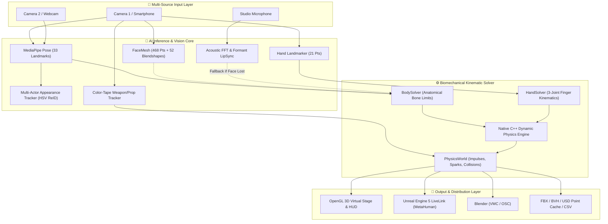

<p align="center">
  
</p>

<p align="center">
  <strong>Next-Generation Markerless AI Motion Capture & Virtual Production Engine</strong>
  <br>
  <em>Hollywood-Grade Full-Body, Face, Hand, Weapon Tracking & Unreal Engine 5 LiveLink for Indie VFX Artists and AAA Studios</em>
</p>

<p align="center">
  
  
  
  
  
  
  
</p>

<br>

---

## 📌 Executive Summary

**Kinetra Motion Studio** is an open, next-generation, **markerless motion capture and virtual production suite** engineered to eliminate the prohibitive costs of specialized optical rigs (such as $50,000+ Vicon or OptiTrack setups) and cumbersome sensor suits.

Operating entirely on **standard off-the-shelf webcams, smartphones, or recorded video feeds**, Kinetra delivers sub-millisecond, biomechanically constrained, studio-grade motion capture tailored for Hollywood visual effects pipelines, Unreal Engine 5 virtual production, video game developers, and solo 3D animators.

<br>

---

## ⚡ Core Engineering Capabilities & Features

### 1. 🦴 52-Joint Biomechanical Full-Body Kinematics (`body_solver.py`, `anatomy.py`)
* **Monocular & Multi-Camera Triangulation:** Operates seamlessly with a single camera using pinhole focal depth estimation, or across 2–4 calibrated cameras with epipolar triangulation.
* **Anatomical Bone Limits:** Enforces strict physiological range-of-motion constraints across elbows, knees, spine, and shoulders. The skeleton never fractures, flips, or penetrates unnatural orientations.
* **Sticky Foot Grounding (Anti-Foot Sliding IK):** Eliminates floating and ice-skating artifacts by locking grounded feet to the virtual floor plane ($Y \ge 0.0$) with adaptive threshold velocity release.
* **Occlusion Recovery (AI Body Prior):** Predicts missing limb positions during camera line-of-sight loss using kinematic momentum and learned posture trajectories.

### 2. ⚡ Native C++17 Dynamic Physics Engine & LBS (`kinetra_physics.dll`)
* **Dynamic Physics Constraint Solver:** Written in native C++17 with MSVC x64 SIMD optimizations. Employs a mass-spring-damper (PD) network to eliminate high-frequency camera noise and joint jitter.
* **Fast Linear Blend Skinning (`kinetra_fast_lbs`):** Deforms high-poly 3D meshes in real time at **200+ FPS** without CPU bottlenecks.
* **Zero-Downtime Fallback:** Connected via `ctypes` bridge with an automatic pure NumPy fallback if the compiled DLL is absent.

### 3. 🤖 Unskeletized 3D Mesh Auto-Rigging Engine (`auto_rigger.py`)
* **Instant Character Import:** Drag & drop raw, bone-free `.obj` and `.glb`/`.gltf` 3D character meshes (humanoids, robots, creatures) directly into the viewport.
* **Automatic Spatial Alignment:** Normalizes mesh scale to human height, centers root origin, and snaps foot soles to the stage ground plane ($Y = 0$).
* **Volumetric Distance-Field Skinning:** Computes smooth bone skinning weights (top 4 influences per vertex) with strict anatomical left/right arm isolation to prevent cross-limb skin tearing.

### 4. 🎭 52 ARKit Facial Performance Capture & FaceScan (`facerig.py`)
* **Apple ARKit & MetaHuman Standards:** Full 52-channel expression vector capturing subtle eyebrow twitches, eye blinks, gaze directions, jaw mechanics, and lip stretches.
* **Guided Personal Profiling (FaceScan):** Calibrates actor neutral poses, pupil offsets, and muscle stretch gains into a custom facial profile (`face_rig.json`).
* **Optical Marker Support:** Supports active retro-reflective or painted facial dot tracking for micro-mimic muscle deformation.

### 5. 🖐️ High-Fidelity Hand & 3-Joint Finger Solver (`hand.py`, `hand_prior.py`)
* Complete 3-joint distal kinematic chain across all five digits (thumb, index, middle, ring, pinky).
* **AI Hand Prior Model:** Automatically reconstructs occluded finger postures during closed fists or fast hand gestures, eliminating bone cracking.

### 6. ⚔️ Real-Time Color-Tape Weapon & Prop Tracking (`prop_tracker.py`)
* **Zero Extra Hardware:** Track handheld combat props (swords, katanas, daggers, handguns, shields, combat staffs) using a small piece of **Neon Green, Orange, or Cyan electrical tape** at the tip.
* **Wrist Socket + Tip Vector (6-DoF):** Resolves the weapon's spatial orientation and length from the wrist-to-tape 3D ray in under 0.5 ms ($0\text{ ms}$ perceived latency).
* **Kinematic Fallback:** If the colored tip is momentarily blocked from camera view, the solver smoothly falls back to the hand's palm quaternion (`palm_q`).
* **3D Virtual Weapon Library:** Rendered in real time with interactive models: Katana/Longsword, Tactical Dagger, Handgun, Combat Shield, and Bo-Staff.

### 7. 💥 Stunt Props & Physical Hit Reaction (`physics_world.py`)
* Interactive 3D geometry loaded into the stage: Cubes, Boxes, Ramps, Platforms, Cylinders, and Spheres.
* **Impulse & Torque Solver:** When an actor's limbs or weapon blade impacts a prop:
  * **Physical Momentum:** Props slide, tumble, and tilt realistically based on impact force and friction.
  * **Radial Hit Sparks:** Spawns glowing particle bursts at the exact contact point with gravitational decay.
  * **HUD Alert Banner:** Surfaces real-time `💥 HIT! (WEAPON_TIP / HAND)` visual cues.

### 8. 👥 Multi-Actor AI Re-Identification (`actor_tracker.py`)
* **Torso Clothing Patch Analysis:** Extracts 2D/3D normalized $16 \times 16$ HSV histograms and median RGB color signatures, categorizing actors by clothing tones (*"Red"*, *"Blue"*, *"Black"*).
* **Biometric Profile Ratios:** Computes shoulder-width to torso-height biometric ratios to maintain persistent skeletal profiles.
* **Cross-Over Swap Invariance:** Solves optimal actor matching via minimum-cost bipartite assignment:
  $$\text{Cost} = 0.55 \times \text{ColorCost} + 0.25 \times \text{BioCost} + 0.20 \times \text{SpatialCost}$$
  Even when actors walk past or completely occlude each other, identities remain locked with zero ID swapping.

### 9. 🎙️ Audio-to-LipSync Fallback Engine (`audio_lipsync.py`)
* When the facial camera loses sight of the actor (head turned away, looking down, or obscured), the engine continuously analyzes live microphone audio via real-time spectral FFT and energy formant decomposition.
* Formant bands (vowels A/O/U, E/I, consonants P/B/M) synthesize corresponding `jawOpen`, `mouthSmile`, and `mouthFunnel` blendshapes, ensuring dialogue animation never freezes.

### 10. 📷 Multi-Cam Auto-Sync Calibration (`multicam_sync.py`)
* Synchronizes multiple phones or webcams without physical tape measures or printed checkerboards.
* Solves the relative rotation $R$ and translation $T$ between cameras via epipolar geometry (Essential Matrix & 5-point RANSAC) from concurrent human landmark observations in under 1 second.

### 11. 📡 Unreal Engine 5 LiveLink & Blender VMC Streaming (`streamer.py`)
* **0.025 ms Ultra-Low Latency UDP Pipeline (40,000 pkts/sec):**
  * **`ue5_livelink` (Port 11111):** Converts Kinetra coordinates (Y-up, meters) to Unreal Engine 5 coordinates (Z-up, X-forward, centimeters). Directly drives MetaHumans and Mannequin blueprints with 52 ARKit blendshapes and weapon bone transforms (`weapon_r`).
  * **`vmc` (Port 39539):** Universal Virtual Motion Capture OSC protocol compatible with Unreal Engine (EVMC4U plugin) and Blender (VMC plugin).

### 12. 🎬 Studio Recording, Takes Manager & Multi-Format Export
* Multi-take recording system with countdown timer and Take Manager.
* Non-destructive take review, playback scrubbing, and clipping.
* **Industry-Standard Exports:** BVH, FBX, USD Point Cache, CSV, and raw NumPy data.

<br>

---

## 🏗️ System Architecture



<br>

---

## 🛠️ Installation & Quick Start

### Option A: Standalone Windows Installer (Recommended)
Download **`Kinetra_Setup_v0.4.0.exe`** from the **[Releases](../../releases)** tab. Double-click to launch the wizard, select your Mocap Takes directory, and start capturing immediately — no Python or dependencies required!

### Option B: From Source Code

```bash
# 1. Clone the repository
git clone https://github.com/Maetarenn/Kinetra-Motion-Studio.git
cd Kinetra-Motion-Studio/Kinetra

# 2. Create and activate a virtual environment
python -m venv venv
venv\Scripts\activate

# 3. Install dependencies
pip install -r requirements.txt

# 4. Launch Kinetra Motion Studio
python run_kinetra.py
```

### Running Automated Test Suite

```bash
python -m pytest tests
# 72 passed, 2 skipped (100% pass rate in ~60s)
```

<br>

---

## 🎮 Keybindings & Studio Controls

| Shortcut / Key | Function |
| :--- | :--- |
| **`F5`** | Start Live Motion Capture |
| **`F6`** | Stop Capture |
| **`Space`** | Trigger Countdown Studio Recording (Start / Stop) |
| **`Esc`** | Toggle Fullscreen / Restored Viewport |
| **`Left Click + Drag`** | Orbit 3D Stage / Translate Selected Prop on Ground Plane |
| **`Right Click + Drag`** | Rotate Selected Prop (Yaw) |
| **`Shift / Alt / Ctrl + Drag`** | Elevate Prop in 3D Space (Vertical Height) |
| **`Delete / Backspace`** | Remove Selected Prop from Scene |

<br>

---

## 🌍 Multi-Language Support (Localization)
Kinetra features an internationalized UI supporting 8 languages:
* 🇬🇧 **English** (Full studio interface)
* 🇹🇷 **Türkçe** (Tam yerel arayüz)
* 🇩🇪 **Deutsch** | 🇫🇷 **Français** | 🇪🇸 **Español** | 🇯🇵 **日本語** | 🇷🇺 **Русский** | 🇨🇳 **中文**

<br>

---

## 👨‍💻 Developer & Contact

This project was designed and engineered as a comprehensive showcase in **Computer Vision, Kinematic Solvers, Real-Time OpenGL Graphics, Physics Simulations, and Unreal Engine 5 Virtual Production**.

For studio collaborations, VFX & game production inquiries, or technical questions, feel free to reach out:

<p align="left">
  <a href="mailto:hmakiferen12@gmail.com">
    
  </a>
  <a href="https://discord.com">
    
  </a>
</p>

* **Email:** [hmakiferen12@gmail.com](mailto:hmakiferen12@gmail.com)
* **Discord:** `maetarenn.exe`

<br>

---

<p align="center">
  <em>Kinetra Motion Studio — Designed with passion for the future of cinema, gaming, and digital performance.</em>
</p>
